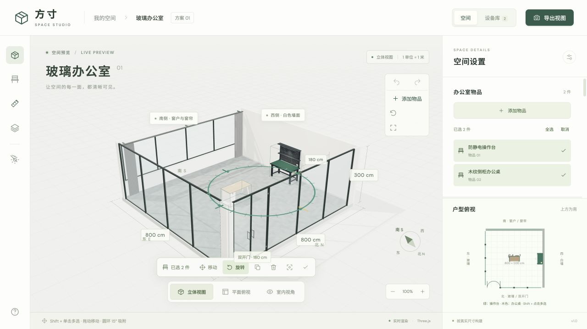

# 方寸 · 玻璃办公室

一个在浏览器中使用的 3D 办公室布局与设备预览工具。按真实尺寸摆放家具、调整光照、查看设备细节，并导出当前视图。

基于 React、Vite 和 Three.js，无需后端服务。模型单位为米，房间界面标注为厘米，设备参数为毫米。



快速查阅：[快速开始](#快速开始) · [支持的功能](#支持的功能) · [操作指南](#操作指南) · [快捷键](#快捷键速查) · [保存与限制](#保存历史与使用边界) · [开发说明](#开发说明)

## 快速开始

### 本地启动

```sh
npm install
npm run dev
```

打开终端显示的本地地址。浏览器需要支持 WebGL 2，并开启硬件加速。

### 构建与离线使用

```sh
npm run build
```

| 构建产物           | 用途                                             |
| ------------------ | ------------------------------------------------ |
| `dist/index.html`  | 用于网站部署；运行 `npm run preview` 可本地预览  |
| `dist/office.html` | 办公室单文件版本，双击即可打开，无需启动服务     |
| `dist/desk.html`   | 单文件版本，默认进入办公桌预览，也可切换到办公室 |
| `dist/chair.html`  | 单文件版本，默认进入办公椅预览，支持后仰与脚托展示 |

单文件版本内置代码、模型和纹理，网络仅用于可选字体；离线时自动使用系统字体。

### 第一次使用

1. 点击「添加物品」，选择操作台、办公桌或办公椅。
2. 拖动物品调整位置，拖动旋转圆环调整朝向。
3. 切换底部视角，在右侧调整时间、窗帘或房间显示。
4. 点击页头「导出视图」保存 PNG；物品布局会自动保存在当前浏览器。

## 支持的功能

| 功能       | 支持内容                                                                          |
| ---------- | --------------------------------------------------------------------------------- |
| 办公室预览 | 8 × 8 × 3 m、64 m² 的玻璃办公室；立体、平面俯视和室内视角                         |
| 物品摆放   | 三款设备可重复添加；支持单件或多件一起移动、旋转、复制、剪切、粘贴和删除          |
| 精细调整   | 1 cm 位置网格吸附、旋转圆环每 15° 刻度附近吸附；单件可输入位置、用滑块调整角度    |
| 户型图联动 | 三维场景、物品列表和户型图同步选择；可直接在户型图上拖动物品                      |
| 编辑历史   | 撤销 / 重做最近 100 步布局操作，支持连续拖动和按键合并为一步                      |
| 自动保存   | 在本机浏览器保存物品种类、数量、位置、朝向和工作灯状态，刷新后恢复                |
| 房间控制   | 窗帘连续开合、双开玻璃门开关、天花板与尺寸标注显隐                                |
| 日光与时间 | 00:00–24:00 时间调节，步长 5 分钟；早晨、中午、傍晚、夜晚预设；光照与阴影实时变化 |
| 展示模式   | 自动环绕、缓慢升降运镜，并循环一天光照；支持暂停、继续和手动接管                  |
| 设备库     | 多角度预览、尺寸与材质说明、参考图查看；工作灯或内部结构演示                      |
| 导出与下载 | 导出当前视图 PNG（含当前可见标注）；下载单件设备 GLB 模型和 JSON 参数             |
| 浏览辅助   | 缩放、平移、重置视角、全屏预览；支持鼠标和触屏手势                                |

### 内置设备

| 设备           | 长 × 深 × 总高       | 特有功能                             |
| -------------- | -------------------- | ------------------------------------ |
| 防静电操作台   | 1500 × 750 × 1800 mm | 台面高 800 mm；可开关工作灯          |
| 木纹侧柜办公桌 | 1400 × 700 × 750 mm  | 设备库内可开启抽屉、柜门和桌面走线盖 |
| 云坐 Z1 人体工学椅 | 660 × 700 × 1180 mm | 灰框灰网脚托款；设备库内可展示 135° 后仰与脚托展开 |

三款设备均可添加到办公室，并独立编辑。设备库的内部结构、工作灯与办公椅后仰预览，与办公室中的摆放状态分开控制。办公椅座高默认 500 mm、总高约 1180 mm，收纳深度 700 mm 为估算预留；详细尺寸依据见 `assets/equipment/office-chair-z1/README.md`。

## 操作指南

### 浏览与房间设置

| 想做什么          | 操作方式                             | 说明                                                                 |
| ----------------- | ------------------------------------ | -------------------------------------------------------------------- |
| 旋转视角          | 在场景空白处按住鼠标左键拖动         | 办公室中拖动物品本体会移动物品，不会旋转镜头                         |
| 平移视角          | 按住鼠标右键拖动                     | 办公室中右键单击则打开添加物品菜单                                   |
| 缩放              | 滚动鼠标滚轮，或点击右下角 `−` / `+` | 适用于办公室和设备预览                                               |
| 触屏浏览          | 空白处单指拖动；双指缩放、平移       | 办公室中单指拖动物品本体可移动物品                                   |
| 切换视角          | 点击场景底部视角按钮                 | 办公室：立体 / 俯视 / 室内；设备库：立体 / 俯视 / 正面 / 背面 / 右侧 |
| 重置视角 / 全屏   | 点击场景右上角对应按钮               | 重置仅恢复立体视角，不清空布局；全屏需浏览器支持                     |
| 显示天花板 / 尺寸 | 使用左侧工具栏或右侧「显示与交互」   | 默认去顶；室内视角自动显示天花板，立体与俯视自动去顶                 |
| 开关玻璃门        | 右侧「显示与交互」→「双开玻璃门」    | 北侧双开门向室内打开 90°                                             |
| 调整窗帘          | 右侧「窗帘控制」滑块或开合按钮       | 0% 为完全闭合，100% 为完全打开                                       |
| 调整光照          | 右侧「日光与时间」滑块或预设按钮     | 早晨 08:00、中午 12:00、傍晚 17:30、夜晚 21:00                       |
| 快速切换日夜      | 点击左侧日光 / 夜景按钮              | 切换至中午 12:00 或夜晚 21:00                                        |
| 导出图片          | 点击页头「导出视图」                 | 保存当前办公室或设备预览为 PNG；需要尺寸时请先开启标注               |
| 查看帮助          | 点击左侧工具栏帮助按钮               | 查看应用内操作说明                                                   |

### 选择与编辑物品

以下操作在「办公室」中使用。多选时，移动、旋转和剪贴板操作作用于整个选区。

| 想做什么            | 操作方式                                                 | 说明                                                           |
| ------------------- | -------------------------------------------------------- | -------------------------------------------------------------- |
| 添加物品            | 点击「添加物品」，或在场景中右键单击                     | 右键点击地面可在该位置添加；也可从设备库点击「添加到办公室」   |
| 选择单件            | 单击场景中的物品、右侧物品列表或户型图中的物品           | 三处选择状态同步                                               |
| 多选 / 取消某件选择 | 按住 `Shift`、`Ctrl` 或 `⌘` 再单击物品                   | 可在场景、列表和户型图中使用                                   |
| 框选                | 按住 `Shift` 在场景空白处拖动                            | 将框内物品加入当前选区                                         |
| 全选 / 取消选择     | 使用右侧列表「全选」/「取消」，或快捷键                  | 单击场景或户型图空白处也可取消选择                             |
| 移动物品            | 拖动物品本体、户型图中的物品，或切换「移动」后拖动控制轴 | 多选后拖动任一选中物品即可整组移动；靠墙时保留组内间距         |
| 精确定位            | 单选后在右侧输入「中心距东墙」「中心距南墙」             | 单位 cm；按 `Enter` 或离开输入框后生效；可用方向按钮微调       |
| 旋转物品            | 切换「旋转」后拖动圆环，或使用右侧旋转按钮               | 圆环支持 360° 旋转；多选时围绕选区中心旋转                     |
| 精确设定角度        | 单选后调整右侧「转向角度」滑块                           | 步长 1°；也可点击左转 15°、右转 15° 或旋转 90°                 |
| 复制 / 剪切 / 粘贴  | 使用物品工具栏、场景上方「粘贴」按钮或快捷键             | 粘贴生成独立物品，保留朝向、工作灯状态和组内间距，并选中新物品 |
| 直接创建副本        | 使用快捷键；多选时也可点击右侧「副本」                   | 无需先复制再粘贴                                               |
| 删除物品            | 点击物品工具栏删除按钮，或使用快捷键                     | 多选时删除整个选区；可撤销                                     |
| 定位近景            | 点击「定位」                                             | 将镜头移近所选物品                                             |
| 开关工作灯          | 选中操作台后使用灯光按钮或 `L`                           | 办公桌不受影响；`L` 可切换选区内各操作台的灯光                 |
| 撤销 / 重做         | 点击场景右上角箭头按钮，或使用快捷键                     | 仅作用于物品布局历史，详见下方说明                             |

### 设备库与展示模式

| 想做什么        | 操作方式                                                     | 说明                                                              |
| --------------- | ------------------------------------------------------------ | ----------------------------------------------------------------- |
| 浏览设备        | 切换到「设备库」，在右侧选择设备                             | 查看尺寸、结构、材质及建模说明                                    |
| 查看内部结构    | 选择办公桌，点击「查看内部结构」或打开「内部结构」开关       | 同时开启抽屉、柜门和桌面走线盖；再次点击收起                      |
| 预览工作灯      | 选择操作台，切换「工作灯与开关」                             | 仅控制设备库预览                                                  |
| 展示办公椅后仰  | 选择办公椅，点击「135° 后仰 · 展开脚托」                     | 再次点击恢复直立收纳；展开时隐藏收纳尺寸标注                        |
| 查看参考图      | 点击右侧设备参考图                                           | 在弹窗中查看大图                                                  |
| 下载模型 / 参数 | 点击「下载 GLB」/「设备信息」                                | 分别下载当前设备的 `.glb` 模型 / `.json` 参数，不是整间办公室布局 |
| 开始展示        | 点击办公室底部「展示模式」                                   | 自动切为去顶立体视图；约 80 秒环绕一周，约 120 秒循环一天         |
| 暂停 / 继续展示 | 再次点击「展示模式」                                         | 镜头与时间同时暂停或继续，按钮保持选中                            |
| 退出展示        | 拖动场景、缩放、切换预设视角、编辑物品、切换设备库或按 `Esc` | 恢复进入展示前的时间；手动调整时间则退出并应用新时间              |

展示期间切到后台标签页会暂停计时。日光采用示意太阳轨迹（日出 06:00、日落 18:00），不对应实际地点与日期。

## 快捷键速查

`⌘ / Ctrl` 表示 macOS 使用 `⌘ Command`，Windows / Linux 使用 `Ctrl`。布局快捷键用于办公室；输入框内保留正常输入与原生复制粘贴行为。

| 功能                | 快捷键 / 组合操作                     | 条件与说明                                             |
| ------------------- | ------------------------------------- | ------------------------------------------------------ |
| 多选 / 取消某件选择 | `Shift` / `Ctrl` / `⌘` + 单击         | 场景、物品列表和户型图均支持                           |
| 框选                | `Shift` + 拖动场景空白处              | 追加选择框内物品                                       |
| 全选物品            | `⌘ / Ctrl + A`                        | 选中办公室中的全部物品                                 |
| 取消选择 / 退出展示 | `Esc`                                 | 退出展示模式，并在正常编辑状态下取消物品选择           |
| 移动 1 cm           | `↑` `↓` `←` `→`                       | 已选中物品；分别向南、北、东、西移动，不随镜头朝向改变 |
| 移动 5 cm           | `Shift` + 方向键                      | 已选中物品                                             |
| 右转 15°            | `R`                                   | 已选中物品；多选时围绕选区中心旋转                     |
| 左转 15°            | `Shift + R`                           | 已选中物品；多选时围绕选区中心旋转                     |
| 切换工作灯          | `L`                                   | 仅影响所选防静电操作台                                 |
| 复制                | `⌘ / Ctrl + C`                        | 已选中物品                                             |
| 剪切                | `⌘ / Ctrl + X`                        | 已选中物品；移除后可粘贴                               |
| 粘贴                | `⌘ / Ctrl + V`                        | 剪贴板中有本应用物品数据；无需保持选中                 |
| 直接创建副本        | `⌘ / Ctrl + D`                        | 已选中物品                                             |
| 删除所选            | `Delete` / `Backspace`                | 可撤销                                                 |
| 撤销                | `⌘ / Ctrl + Z`                        | 恢复上一步布局操作                                     |
| 重做                | `⌘ / Ctrl + Shift + Z`，或 `Ctrl + Y` | 恢复已撤销的布局操作                                   |
| 选择户型图物品      | `Space`                               | 键盘焦点位于户型图中的物品上；配合选择修饰键可多选     |
| 定位户型图物品      | `Enter`                               | 键盘焦点位于户型图中的物品上                           |

## 保存、历史与使用边界

- **自动保存**：布局保存在当前浏览器的本地存储中，不是云端同步。清除浏览器数据会丢失布局；更换浏览器或访问地址不会自动迁移。相机视角、时间、窗帘等房间设置不随布局保存。
- **撤销范围**：包括添加、删除、剪切、粘贴、创建副本、移动、旋转和工作灯状态。一次连续拖动、旋转滑块调整或按住方向键 / `R` 合并为一步；选择操作不占历史，相机和房间设置不计入历史。刷新后保留布局，但重新开始编辑历史。
- **剪贴板**：支持在本应用页面间复制粘贴物品。浏览器限制系统剪贴板时，可使用同页工具栏复制、剪切和粘贴；取消选择或剪切至空房间后仍可粘贴。
- **布局约束**：物品按旋转后的占地限制在房间边界内，但不提供物品间碰撞阻挡；仍需自行检查重叠与通行空间。目前不支持在界面中修改房间尺寸或导入自定义设备模型。
- **模型用途**：用于布局与外观预览。部分设备细部尺寸按参考图估算，具体见设备库「建模说明与待确认项」，不能代替施工或加工图纸。

## 房间模型说明

平面朝向固定为：上南、下北、左东、右西。

| 项目           | 尺寸与设定                                                                         |
| -------------- | ---------------------------------------------------------------------------------- |
| 房间           | 800 × 800 × 300 cm，面积 64 m²                                                     |
| 东侧玻璃墙     | 6 格均分，每格约 118.33 cm、7 根 5 cm 立柱、起端 20 cm 和末端 35 cm 墙边柱，总长 800 cm |
| 北侧玻璃墙     | 4 个 180 cm 开间、5 根 5 cm 立柱、起端 20 cm 和末端 35 cm 墙边柱，总长 800 cm |
| 北侧玻璃门     | 最左开间为 180 cm 双开门，单扇 90 cm，向室内开启 90°；暂按通高制作                 |
| 南侧窗户与窗帘 | 窗底距地 100 cm、窗顶高 280 cm，中间承重墙宽 65 cm；两组窗户各配一对落地褶皱窗帘，共两对四片，同步开合 |
| 踢脚线         | 实体墙沿地面设置，高 10 cm |
| 西侧墙面       | 纯白墙面                                                                           |
| 地面           | 10 × 10 块 80 cm 灰色大理石板，纹理在本地程序生成                                  |
| 天花板         | 60 cm 方格板，每方向 13 块整板居中，四周各 10 cm 收边                              |

东侧玻璃墙分段：`20 + 7 × 5 + 6 × 118.333… + 35 = 800 cm`，6 格均分。北侧分段：`20 + 5 + 180 + 5 + 180 + 5 + 180 + 5 + 180 + 5 + 35 = 800 cm`，首个开间由双开门替代。南侧两组窗户在 65 cm 承重墙两边对称设置，保留两端各 20 cm 墙体，每组窗宽 347.5 cm。

## 开发说明

### 常用命令

| 命令                       | 用途                                    |
| -------------------------- | --------------------------------------- |
| `npm run dev`              | 启动开发服务                            |
| `npm run build`            | 导出设备模型、构建网站并生成单文件 HTML |
| `npm run preview`          | 预览生产构建                            |
| `npm run equipment:export` | 重新生成设备 GLB 模型                   |
| `npm run lint`             | 检查 JavaScript、JSX 与 React Hooks     |
| `npm test`                 | 运行布局、编辑历史、剪贴板与日光测试    |
| `npm run check`            | 依次执行静态检查、测试与生产构建        |
| `npm run format`           | 格式化源码及构建 / 静态检查配置         |

### 主要目录

| 路径                          | 职责                                        |
| ----------------------------- | ------------------------------------------- |
| `src/App.jsx`                 | 页面入口、工作区切换、布局状态与快捷键      |
| `src/scene.js`                | Three.js 渲染、预设视角、三维交互与图片导出 |
| `src/room-spec.js`            | 房间几何参数                                |
| `src/daylight.js`             | 时间预设、太阳轨迹与光照插值                |
| `src/equipment/`              | 设备建模、目录、布局、编辑历史与剪贴板逻辑  |
| `src/components/`             | 工具栏、房间控制、设备信息与户型图          |
| `src/hooks/useOfficeScene.js` | 场景生命周期与资源释放                      |
| `src/style.css`               | 公共样式与响应式布局                        |
| `assets/equipment/`           | 设备参数、参考图、GLB 模型与建模说明        |
| `scripts/`                    | 自动化测试、模型导出与单文件 HTML 打包      |
